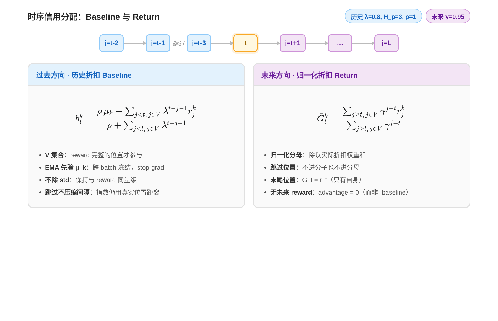
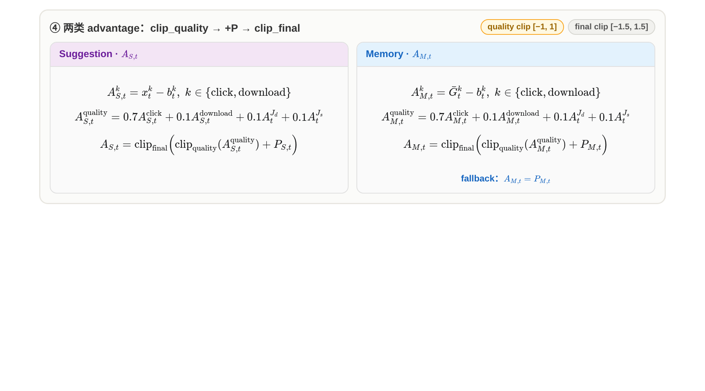

# Baseline 与时序信用分配

> 本文档总结自 Agentic Memory RL 训练文档中关于信用分配（Credit Assignment）与 Advantage 计算的核心设计章节。

信用分配沿轨迹两个方向进行：**过去方向**用折扣平均 baseline 衡量"位置 t 之前的平均水平"，**未来方向**用归一化折扣 return 衡量"位置 t 之后能拿到多少奖励"。两者相减即得到该位置的时序 advantage。

---

## 为什么是"未来 return − 过去 baseline"的结构？

这不是简单的统计平均，而是对 memory 更新施加**单调性约束**：

- **过去 baseline 作为下界**：之前生成的 memory + sug 是"信息更少"的基线——那时 memory 还没吸收本轮新信息。我们这一轮更新了 memory，理应在点击率、多样性等方面不输于之前的表现。baseline 回答的是："这次更新 memory 后，比以前更好了吗？"
- **未来 return 作为上界**：之后生成的 memory + sug 会有更多信息，我们希望当前 memory 有承接性——它应该为后续表现铺路，而不是只优化当前这一步 sug，导致 memory 越更新越腐化（比如把有用的历史信息覆盖掉）。future return 回答的是："这次 memory 更新，对后续轨迹是正贡献还是负贡献？"

两者相减，advantage 同时衡量了"不退化"（相对过去）和"能承接"（面向未来），这正是 agentic memory 单 policy RL 的核心诉求。

---

## 历史折扣 baseline $b_t^k$

click / download 的历史 baseline 是过去有效位置的折扣平均，叠加跨 batch EMA 先验：

$$b_t^k = \frac{\rho\,\mu_k+\sum_{j<t,\,j\in V}\lambda^{t-j-1}r_j^k}{\rho+\sum_{j<t,\,j\in V}\lambda^{t-j-1}}$$

**参数默认值**：

| 参数 | 默认值 | 含义 |
|------|--------|------|
| $\rho$ | $1$ | EMA 先验权重 |
| $H_p$ | $3$ | 只保留最近三个有效历史位置 |
| $\lambda$ | $0.8$ | 历史折扣因子 |

选择 $H_p=3$ 是 bias-variance 权衡的结果：$\lambda=0.8$ 时 3 步前的权重已衰减到 0.64，再多保留边际贡献很小；而 RL 每 batch 都更新策略，太远的历史数据分布已过时，保留太多反而引入系统性偏差。轨迹首部历史不足时由 EMA 先验兜底，无需靠拉长窗口凑样本。

**设计细节**：

- **V 集合**：质量 reward 完整且可用于时序 credit 的位置集合。只有 reward 完整的位置才进入 baseline 计算，避免脏数据污染。
- **跨 batch EMA 先验 μ_k**：此前完成 batch 的 reward EMA，当前 batch 内**冻结并 stop-gradient**。fresh run 优先从 SFT held-out baseline 各 head 均值初始化。这一项解决了轨迹首部历史不足的问题——早期位置主要靠 μ_k 打底，而不是凭空估计。
- **不除以标准差**：保持 advantage 与 reward-baseline 同量级。归一化到单位方差会让小信号被放大噪声，V2 选择直接用原始量级。
- **跳过位置既不进分子也不进分母**：无效位置不参与信用分配。

---

## 未来归一化折扣奖励 $\bar{G}_t^k$

Memory 动作需要评估其对后续轨迹的影响，因此用未来折扣 return：

$$\bar G_t^k = \frac{\sum_{j\ge t,\,j\in V}\gamma^{j-t}r_j^k}{\sum_{j\ge t,\,j\in V}\gamma^{j-t}}$$

**参数默认值**：$\gamma=0.95$（未来折扣因子）。

**设计细节**：

- **归一化分母**：除以实际折扣权重和，而不是简单的 $\gamma^{j-t}$ 求和。这样轨迹首部不会因为"拥有更多未来 reward"就天然得到更大的 advantage——所有位置的 return 都被缩放到同一量级。
- **末尾位置**：轨迹末尾有效位置的 $\bar{G}_t^k = r_t^k$（只有自身一个未来项）。
- **无未来 reward 的特殊处理**：若某 Memory 位置后面没有任何有效 reward，该位置的质量 advantage 为 **0**，而不是 $-$baseline。这是因为没有观测到后果，不能假定性为负面。
- **跳过位置既不进分子也不进分母**：无效位置不参与信用分配。

**首尾平衡**：轨迹首部历史少，baseline 更多依赖跨 batch EMA 先验；Memory return 则观察较多后续位置。但由于未来 return 除以实际折扣权重和，首部不会因为"看到更多未来"就天然获得更大 advantage。

---

## Suggestion vs Memory Advantage

同一轨迹位置上有两类动作——**Suggestion**（生成具体建议内容）和 **Memory**（写入/更新记忆）。它们的 advantage 计算方式不同，因为它们的信用来源不同。

### Suggestion Advantage

Suggestion 的质量信号是多源加权：

$$A_{S,t}^{\text{quality}} = 0.7 A_{S,t}^{\text{click}} + 0.1 A_{S,t}^{\text{download}} + 0.1 A_t^{J_d} + 0.1 A_t^{J_s}$$

其中 click / download 的 advantage 是单步信号（仅减去历史 baseline，不做未来累计）：

$$A_t^{J_s}=r_t^{J_s}-\mu_{J_s},\quad A_t^{J_d}=r_t^{J_d}-\mu_{J_d}$$

最终 advantage 经过两级 clip 和 penalty（**防止长尾 reward 主导梯度，同时不丢失格式惩罚**）：

$$A_{S,t} = \operatorname{clip}_{\text{final}}\left(\operatorname{clip}_{\text{quality}}(A_{S,t}^{\text{quality}}) + P_{S,t}\right)$$

- **quality clip**：$[-1, 1]$
- **final clip**：$[-1.5, 1.5]$

**Penalty 机制**：$P_{S,t} \in \{0, -0.1, -0.3\}$。严重解析失败时直接令 $A_{S,t} = -0.3$，不计算该步 quality advantage；prompt overflow 或空输出没有可归因 policy token，保持 zero-mask。

### Memory Advantage

Memory 动作影响后续轨迹，因此用时序信用分配：

$$A_{M,t}^{k}=\bar G_t^k-b_t^k,\quad k \in \{\text{click}, \text{download}\}$$

其余与 Suggestion 同式加权与 clip。Memory 的 penalty $P_{M,t}$ 只作用于当前 Memory，包括：

- Memory 超过 1024 token
- transition fallback（$-$0.2）
- 无法生成任何 Suggestion policy token 时的归因

Memory 内部 schema 错误仍只诊断——能恢复出 update / no_update 和完整 state 时不处罚。

---

### 核心差异：为什么不同

| 维度 | Suggestion | Memory |
|------|-----------|--------|
| **信用来源** | 单步即时信号（click / download / LLM-as-judge） | 时序信用分配（未来归一化折扣 return − 历史 baseline） |
| **设计原因** | Suggestion 是"当前这一步说得好不好"，效果即时可观测，不需要等未来。click/download 只减历史 baseline 的 EMA，不做未来累计。 | Memory 是"写入这条记忆对后续对话有没有用"，效果体现在未来的 click/download 上，必须用未来 return 做信用分配。 |
| **Penalty 范围** | $P_{S,t}$ 作用于当前 Suggestion 动作 | $P_{M,t}$ 作用于当前 Memory 动作；schema 错误可恢复时不处罚 |

---

### Fallback 特例

当 $\text{memory\_transition\_fallback} = \text{True}$ 时：

$$A_{M,t} = P_{M,t}$$

即直接取 penalty，该 Memory 不获得当前或未来质量 credit，环境复用旧 Memory 继续后续轨迹。该位置 Suggestion 如果有效仍可训练自身，但从其他 action 的历史 baseline 和 future return 中跳过——即这个位置的 reward 不再作为其他位置的 baseline 参考或未来 return 来源。
